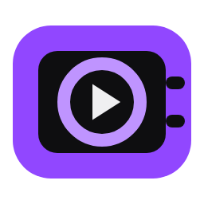
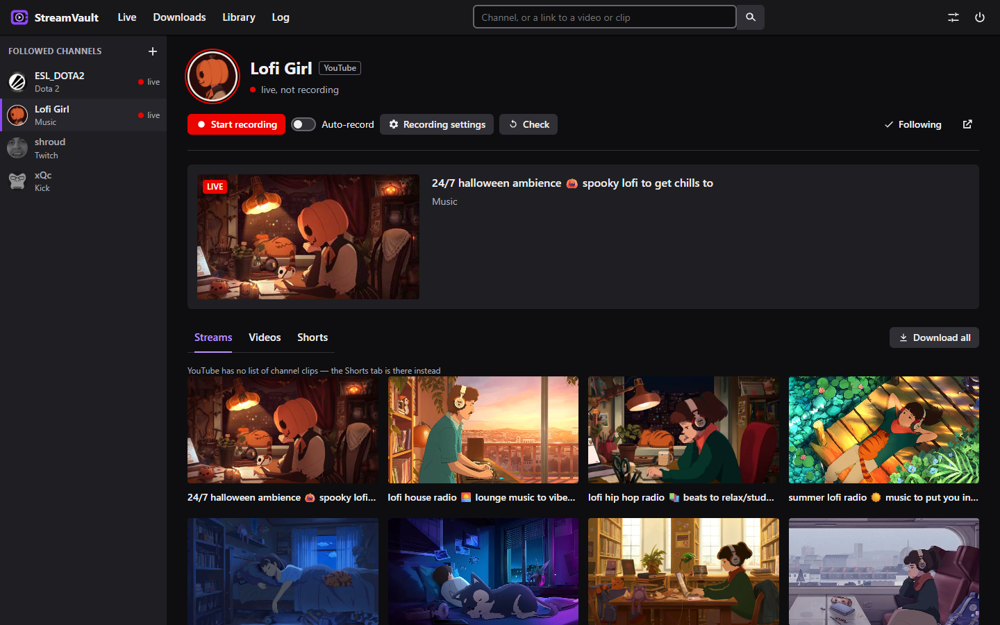

<p align="center">
  
</p>

<h1 align="center">StreamVault</h1>

<p align="center">
  <a href="https://github.com/Hxrmfull/StreamVault/releases/latest"></a>
  <a href="https://github.com/Hxrmfull/StreamVault/releases"></a>
  
  <a href="LICENSE"></a>
</p>

<p align="center"><b>English</b> · <a href="README.ru.md">Русский</a></p>

Records live streams and downloads VODs and clips from **Twitch**, **Kick**,
**YouTube** and **VK Video Live**, chat included. Follow channels and see who
is live, record with one click or automatically, and watch recordings with
the chat running alongside, all in a window that looks like a streaming site.

The interface is in English and Russian; switch the language in the settings.



## Download

Windows 10/11, 64-bit — `StreamVault-<version>-windows.zip` on the
[releases](../../releases) page. Unzip it and run `StreamVault.exe`; keep the
**whole folder** (the `_internal` folder next to the exe is required).

- **No accounts or API keys needed.** The app asks the platforms the same
  way their websites do for a viewer who is not logged in.
- **FFmpeg** is not bundled: the app finds an installed one or downloads it
  with a button in the window (a [gyan.dev](https://www.gyan.dev/ffmpeg/builds/)
  build, checked against its checksum).
- **SmartScreen** ("Windows protected your PC"): the app has no digital
  signature. Click "More info" → "Run anyway".
- **Portable:** settings, logs and the downloaded FFmpeg live in the app
  folder, or in `%APPDATA%\StreamVault` if that folder is read-only.

## Features

- **Channels:** search all four platforms at once by name, or paste a link.
  The sidebar shows who is live, with avatars, viewers and stream previews.
- **Recording:** a "Start recording" button or auto-record for every stream
  (off by default). Each channel has its own recording settings: quality,
  chat, recording from the start, MP4 conversion, splitting and how long to
  keep recordings.
- **From the very start:** if recording begins mid-stream, the part before it
  is downloaded from the platform's own archive and saved as the first part.
- **Chat:** live chat of all four platforms is saved next to the recording;
  VOD and clip chat downloads as HTML, JSON or a rendered chat video.
- **Downloads:** VODs, highlights and clips from a link or a channel tab,
  quality choice, only a section of a video, "Download all" for a whole tab.
  Paused and interrupted downloads resume, even after a restart.
- **Library and player:** everything recorded and downloaded, with
  thumbnails, filters and disk usage. Watch in the window with synced chat,
  keyboard shortcuts and speed control, even while it is still recording;
  cut a clip or burn the chat video into the picture.
- **Safety:** stops recording before the disk fills up, can move old
  recordings to the Recycle Bin, and checks recordings for gaps.
- **In the background:** closing the window keeps it in the tray, with
  notifications and an optional start with Windows.

## What each platform supports

| Feature | Twitch | Kick | YouTube | VK Video Live |
|---|---|---|---|---|
| Channel search | by part of the name | by part of the name | yes, via yt-dlp | exact name only |
| Live preview, avatar | yes | yes | yes | yes |
| Live chat | yes | yes | yes | yes |
| Record from the start | right away (if the channel keeps past broadcasts) | right away | after the stream ends | after the stream ends |
| Channel page tabs | past broadcasts, highlights, uploads, clips | VODs, clips | live, videos, Shorts | VODs, clips |
| Channel clips | yes | yes | no — YouTube has no clip list; the Shorts tab instead | yes |
| VOD and clip chat | yes | yes | for past live streams | yes |

## Running from source

Python 3.12+:

```bash
pip install -r requirements.txt
python -m streamvault                    # the window
python -m streamvault record             # record channels with auto-record on, in the console
python -m streamvault download <link>    # download a VOD or clip
```

`python -m streamvault --help` lists all commands. Windows build (makes
`dist\StreamVault` and the release archive):

```bash
python packaging/build.py
```

## Other

- **Updates:** on start the app checks GitHub for a new release and shows
  an update button. The downloaded archive must match the size and SHA-256
  that GitHub reports; settings and recordings are kept. yt-dlp updates
  separately with a button in the settings, without a new release.
- **Subscriber-only VODs on Twitch:** paste your `auth-token` cookie into
  the settings; it stays in `settings.json` on your computer.
- **Changelog** — [CHANGELOG.md](CHANGELOG.md).

## Licenses

Code — [MIT](LICENSE). The Windows build bundles
[streamlink](https://streamlink.github.io/) (BSD-2-Clause),
[yt-dlp](https://github.com/yt-dlp/yt-dlp) (Unlicense),
[pywebview](https://pywebview.flowrl.com/) (BSD-3-Clause),
[pystray](https://github.com/moses-palmer/pystray) (LGPL-3.0) and other
libraries under their own licenses. FFmpeg (GPL) and
[TwitchDownloader](https://github.com/lay295/TwitchDownloader) (MIT) are not
bundled: the app downloads them when you ask for them.
