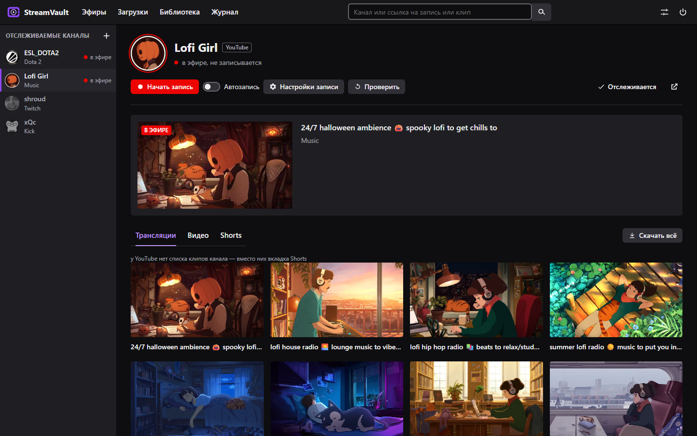

<p align="center">
  
</p>

<h1 align="center">StreamVault</h1>

<p align="center">
  <a href="https://github.com/Hxrmfull/StreamVault/releases/latest"></a>
  <a href="https://github.com/Hxrmfull/StreamVault/releases"></a>
  
  <a href="LICENSE"></a>
</p>

<p align="center"><a href="README.md">English</a> · <b>Русский</b></p>

Запись прямых эфиров и скачивание записей и клипов с **Twitch**, **Kick**,
**YouTube** и **VK Video Live** — вместе с чатом. Отслеживайте каналы и
смотрите, кто в эфире, пишите эфир одной кнопкой или автоматически и
смотрите записи с чатом рядом — в окне в стиле стриминговой площадки.

Интерфейс на русском и английском, язык переключается в настройках. Консольные
команды говорят на том же языке.



## Скачать

Windows 10/11, 64 бита — страница [релизов](../../releases).

| Файл | Что это |
|---|---|
| `StreamVault-<версия>-setup.exe` | Установщик — проще всего: выбор папки, прав администратора не нужно |
| `StreamVault-<версия>-windows.zip` | Переносная: распаковать и запустить `StreamVault.exe` |

Переносная версия работает из любой папки; переносите **всю папку** (папка
`_internal` рядом с exe обязательна). Обе версии обновляются из программы.

- **Аккаунты и ключи API не нужны.** Программа спрашивает площадки так же,
  как их сайты — у зрителя без входа.
- **FFmpeg** в сборку не входит: программа найдёт установленный или скачает
  его кнопкой из окна (сборка [gyan.dev](https://www.gyan.dev/ffmpeg/builds/),
  сверяется по контрольной сумме).
- **SmartScreen** («Система Windows защитила ваш компьютер»): у программы нет
  цифровой подписи. Нажмите «Подробнее» → «Выполнить в любом случае».
- **Настройки, журналы и скачанный FFmpeg** хранятся в папке программы,
  а если туда писать нельзя (установка для всех в Program Files) —
  в `%APPDATA%\StreamVault`.

## Возможности

- **Каналы:** поиск по имени сразу на всех четырёх площадках или ссылка.
  Слева — кто в эфире: аватарки, зрители, кадры трансляций.
- **Запись:** кнопка «Начать запись» или автозапись каждого эфира
  (по умолчанию выключена). У каждого канала свои настройки записи:
  качество, чат, запись с начала эфира, конвертация в MP4, деление на куски
  и срок хранения.
- **С самого начала:** если запись началась посреди эфира, его начало
  скачивается из записи эфира на самой площадке и ложится первой частью.
- **Чат:** чат эфира всех четырёх площадок пишется рядом с записью; чат
  записей и клипов скачивается в HTML, JSON или видео чата.
- **Загрузки:** записи эфиров, хайлайты и клипы по ссылке или со вкладки
  канала, выбор качества, только отрезок видео, «Скачать всё» — вся вкладка.
  Пауза и обрыв не страшны: загрузка продолжится, даже после перезапуска.
- **Библиотека и проигрыватель:** всё записанное и скачанное с превью,
  фильтрами и местом на диске. Смотрите в окне с чатом в такт видео,
  горячими клавишами и скоростью — даже пока запись ещё идёт; вырежьте клип
  или наложите видео чата на картинку.
- **Сохранность:** запись останавливается раньше, чем кончится место на
  диске, старые записи можно отправлять в корзину, записи проверяются на
  пропуски.
- **В фоне:** крестик сворачивает окно в трей, приходят уведомления, есть
  запуск вместе с Windows.

## Что умеет каждая площадка

| возможность | Twitch | Kick | YouTube | VK Video Live |
|---|---|---|---|---|
| поиск каналов по имени | да, по части имени | да, по части имени | да, через yt-dlp | да, по части имени или ника |
| имя и аватарка канала | да | да | да | да |
| кадр идущего эфира | да | да | да | да |
| чат эфира | да | да | да | да |
| запись с начала эфира | да, сразу (если у канала включён архив прошедших эфиров) | да, сразу | да, после конца эфира | да, после конца эфира |
| вкладки страницы канала | да: записи эфиров, хайлайты, загруженное, клипы | да: записи, клипы | да: трансляции, видео, Shorts | да: записи, клипы |
| клипы канала | да | да | нет — у YouTube нет списка клипов канала, вместо них вкладка Shorts | да |
| чат записей и клипов | да | да | да, у прошедших эфиров | да |

## Запуск из исходников

Python 3.12+:

```bash
pip install -r requirements.txt
python -m streamvault                    # окно программы
python -m streamvault record             # запись каналов с автозаписью, в консоли
python -m streamvault download <ссылка>  # скачать запись или клип
```

Все команды — `python -m streamvault --help`. Сборка для Windows (папка
`dist\StreamVault` и архив; установщику нужен
[Inno Setup 6](https://jrsoftware.org/isdl.php)):

```bash
python packaging/build.py                          # программа и архив
python packaging/release.py <версия> --dry-run     # плюс установщик
```

## Прочее

- **Обновления:** при запуске программа спрашивает у GitHub, нет ли новой
  версии, и показывает кнопку обновления. Установленная копия скачивает
  и запускает новый установщик, переносная — новый архив; файл обязан
  совпасть по размеру и SHA-256 с тем, что сообщает GitHub. Настройки
  и записи остаются. yt-dlp обновляется отдельно — кнопкой в настройках, без нового
  релиза.
- **Записи Twitch только для подписчиков:** вставьте в настройках куку
  `auth-token`; она остаётся в `settings.json` на вашем компьютере.
- **История изменений** — [CHANGELOG.ru.md](CHANGELOG.ru.md).

## Лицензии

Код — [MIT](LICENSE). Сборка для Windows включает
[streamlink](https://streamlink.github.io/) (BSD-2-Clause),
[yt-dlp](https://github.com/yt-dlp/yt-dlp) (Unlicense),
[pywebview](https://pywebview.flowrl.com/) (BSD-3-Clause),
[pystray](https://github.com/moses-palmer/pystray) (LGPL-3.0) и другие
библиотеки со своими лицензиями. FFmpeg (GPL) и
[TwitchDownloader](https://github.com/lay295/TwitchDownloader) (MIT) в сборку
не входят: программа скачивает их, когда они нужны.
